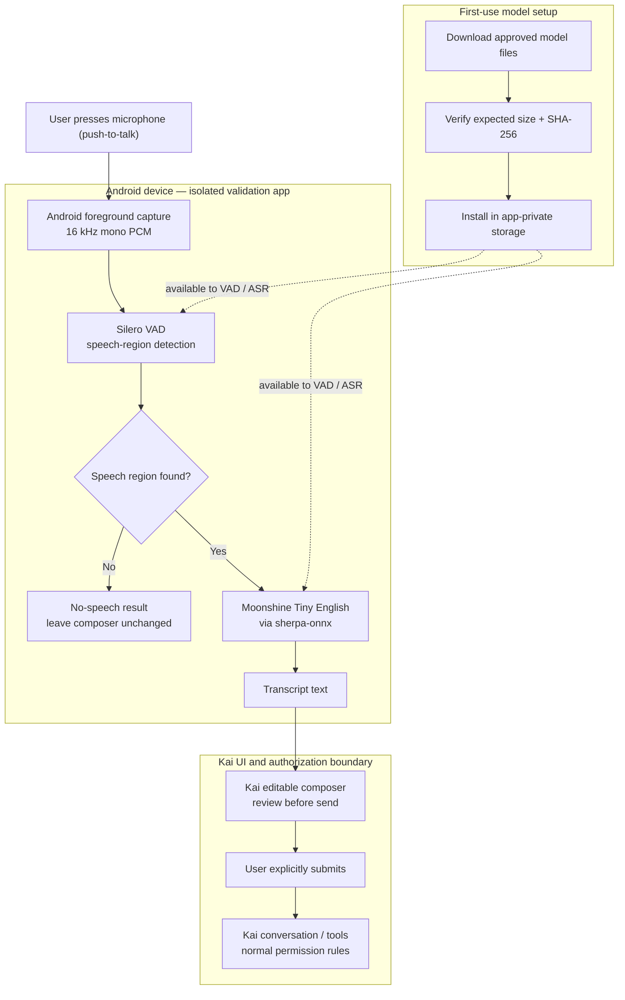
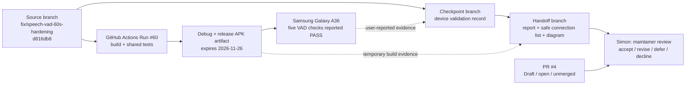

# Kai Offline Speech Input — System Map

This is the high-level flow for maintainers and testers. It shows the boundaries between the Android app, offline speech pipeline, GitHub build/review, and the physical test device.

## Engineering and review map

## What each part is

| Part | Responsibility |
|---|---|
| Android capture | Foreground push-to-talk audio capture, bounded to the app's recording limit |
| Silero VAD | Detects speech regions before recognition; rejects silence/noise-only input |
| Moonshine Tiny | Performs local English speech recognition through sherpa-onnx |
| Editable composer | Receives transcript as draft text for user review |
| User submission | Explicit user action; spoken words alone do not authorize tools |
| GitHub Actions | Builds Android FOSS debug/release variants and runs shared desktop tests |
| Artifact | Temporary ZIP containing validation APKs; download before expiry |
| Galaxy A36 | One-device functional test evidence; not a broad compatibility claim |
| Checkpoint / handoff branches | Preserve validation record and forwardable maintainer documentation |
| PR #4 | Existing draft contribution; keep unmerged pending review and explicit approval |

## Boundaries

- No always-on microphone, wake word, diarization, cloud transcription, or paid speech API.
- No automatic tool authorization from recognized speech.
- Keep optional auto-send disabled during the initial preview.
- Run #60 is tied to the VAD validation branch and commit, not assumed to validate PR #4's current head.
- The Galaxy A36 results are reported by the user; no statistical benchmark is claimed.
